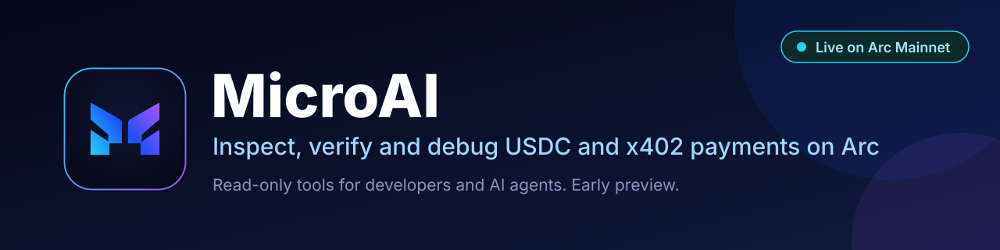

<p align="center">
  
</p>

<p align="center">
  
</p>

<p align="center">
  <a href="https://github.com/sahmedonchain/microai/actions/workflows/ci.yml"></a>
  <a href="https://github.com/sahmedonchain/microai/actions/workflows/github-code-scanning/codeql"></a>
  
  
  
  
</p>

<p align="center">
  <a href="https://microai-tan.vercel.app"><b>Live app</b></a> ·
  <a href="https://microai-tan.vercel.app/verify">Verify</a> ·
  <a href="https://microai-tan.vercel.app/inspect">Payload inspector</a> ·
  <a href="https://microai-tan.vercel.app/lab">Testnet lab</a> ·
  <a href="#connect-an-ai-agent-mcp">MCP</a> ·
  <a href="https://microai-tan.vercel.app/security">Security</a> ·
  <a href="#roadmap">Roadmap</a>
</p>

**MicroAI is a set of read-only developer tools for checking USDC and [x402](https://www.x402.org) payments on [Arc](https://docs.arc.io).** Give it an endpoint, a payment header or a transaction hash and it tells you, with evidence, what is right, what is wrong and how to fix it. It never sends a payment and never asks for a private key or seed phrase. It is free to use, with rate limits, and live on Arc Mainnet.

> [!NOTE]
> **Early preview.** Live on Arc Mainnet, built and maintained by one developer. It has not been independently audited, and it is an independent project, not an official Arc or Circle product. See [What is and is not verified](#what-is-and-is-not-verified).

## Contents

- [Why it exists](#why-it-exists)
- [What you can do with it](#what-you-can-do-with-it)
- [Connect an AI agent (MCP)](#connect-an-ai-agent-mcp)
- [What is and is not verified](#what-is-and-is-not-verified)
- [What a Verify report looks like](#what-a-verify-report-looks-like)
- [Live today](#live-today)
- [How it works](#how-it-works)
- [On-chain details](#on-chain-details-arc-mainnet)
- [Security](#security)
- [Reference: API routes and project structure](#reference)
- [Tech stack](#tech-stack)
- [Local development](#local-development)
- [Testing and CI](#testing-and-ci)
- [Roadmap](#roadmap)
- [Contributing and feedback](#contributing-and-feedback)
- [Author](#author)

## Why it exists

Paying with USDC on Arc looks simple, but the mistakes are easy to make and usually show up after real money has moved:

| Common mistake | What goes wrong |
|---|---|
| USDC has 6 decimals in its ERC-20 interface but 18 as the native gas token | Wrong amount, off by a factor of a million or more |
| A Testnet address or chain used on Mainnet | Money sent to the wrong place, or the transaction fails |
| Wrong chain ID, asset or recipient in a `402` answer | A client pays the wrong network or the wrong person |
| A malformed x402 payment response | Agents and clients cannot pay at all |
| A payment that succeeded but a service that did not deliver | Money moved, nothing received |

MicroAI checks for these before and after a payment, in plain language, without touching any money.

## What you can do with it

| Tool | For | What it does |
|---|---|---|
| **[Verify](https://microai-tan.vercel.app/verify)** | Anyone building or paying an x402 endpoint | Reads an endpoint's `402` answer (no payment sent) and checks the network, USDC address, 6-vs-18 decimals, recipient and format. Optionally matches a transaction on Arc against what the endpoint asked for, and says what a service answered after payment. Reports can be shared by link |
| **[Payload inspector](https://microai-tan.vercel.app/inspect)** | x402 integrators | Decodes `PAYMENT-REQUIRED`, `PAYMENT-SIGNATURE` and `PAYMENT-RESPONSE` **in your browser only**. Nothing is sent or stored, because a signed payload can move money until it is used |
| **[Testnet lab](https://microai-tan.vercel.app/lab)** | Anyone who wants to try it safely | Test endpoints with one known mistake each, and small Testnet payments from your own wallet, so you can see how Verify judges them |
| **Trust API** | Agents and scripts | `GET /api/trust?url=...` returns a machine-readable check of an endpoint's payment setup. It is a configuration check, not a reputation score |
| **[MCP server](#connect-an-ai-agent-mcp)** | AI agents | Read-only tools an agent can call to check an endpoint before paying |
| **Debug** | Arc developers | Paste a transaction hash: status, transfers, the decoded function, and a diagnosis from chain data. Revert reasons and events are decoded locally and each finding is labelled confirmed, probable or unknown. An AI explanation follows and is marked as possibly wrong |
| **Wallet, Stats, Ecosystem, News, Build status** | Arc community | Address lookup with risk signals, network and payment-wallet stats, a directory of Arc and Circle projects, news and repository activity |

Full panel list: [Live today](#live-today).

## Try it in a minute

1. Open **[Verify](https://microai-tan.vercel.app/verify)** and paste a test endpoint: `https://microai-tan.vercel.app/api/lab/x402/good` (a correct one) or `https://microai-tan.vercel.app/api/lab/x402/decimals18` (a deliberate 6-vs-18 decimals mistake). It sends no payment.
2. Or open the **[Payload inspector](https://microai-tan.vercel.app/inspect)** and paste an x402 header to read it.

## Connect an AI agent (MCP)

MicroAI runs a small, read-only [MCP](https://modelcontextprotocol.io) server. Add this URL as a custom connector in an MCP client such as Claude, with no login:

```text
https://microai-tan.vercel.app/api/mcp
```

| Tool | What it does |
|---|---|
| `check_x402_endpoint` | Checks an endpoint's payment setup on Arc (same engine as the Trust API) |
| `explain_x402_error` | Explains a facilitator error code in plain words |
| `arc_network_info` | Chain IDs, RPC and explorer URLs, USDC address and decimals |

Then ask, for example: *"Use MicroAI to check https://microai-tan.vercel.app/api/lab/x402/good"*. The server can only read: it sends no payment, accepts no signed payload and holds no keys. It was tested with the official MCP TypeScript SDK client and in the Claude app. Details: [`lib/mcp/server.ts`](lib/mcp/server.ts).

## What is and is not verified

MicroAI would rather under-claim. This is the current state, stated plainly.

| Area | State |
|---|---|
| Arc configuration (chain IDs `5042` and `5042002`, RPC, explorer, USDC address and decimals) | Matches the official Arc docs, checked 10 Nov 2026 |
| x402 v2 headers and the `exact` scheme (parsing and the checks above) | Implemented and unit tested |
| Automated tests | Several hundred; **all use mocks** for Redis, the Arc RPC and the AI provider |
| Live end-to-end run with a real wallet and a real x402 service on Arc Testnet | **Not done yet.** This is the next milestone, with transaction hashes to be published |
| Facilitator `/verify` and `/settle` | **Never called, on purpose:** they take a signed payment and `/settle` moves money |
| Service delivery | Judged only from what *you* report the service answered; MicroAI sends no payment, so it cannot see it |
| Independent security audit | **None.** Do not rely on MicroAI for large amounts |
| AI explanations (Debug, Wallet) | Can be wrong; they are labelled |

How it is built and defended is under [Security](#security).

## What a Verify report looks like

A developer gives Verify an x402 endpoint (and optionally a transaction hash). It reads the endpoint's `402` answer **without sending any payment** and returns a plain-language report: OK, warning or error for each check, the reason, the evidence and how to fix it.

<details>
<summary>Illustrative mock-up of a Verify report (not live)</summary>

```text
MicroAI Verify  -  mock-up, not a real result
Endpoint: https://api.example.com/paid      Network: Arc Mainnet (5042)

[OK]     Network     402 response names chain 5042, matching Arc Mainnet
[ERROR]  Amount      Response asks for 1000000000000000000 units of USDC.
                     That is 1 USDC with 18 decimals, but the USDC interface uses 6,
                     so a client would be asked for 1,000,000,000,000 USDC.
                     Evidence: field "amount" in the 402 response
                     Fix: use 1000000 for 1 USDC.
[WARN]   Recipient   Address is valid but was never used before on Arc Mainnet.
                     Check it is the address you intended.
```

</details>

What it will **not** do: send payments, score or rate services, call a service good or bad, or check any network other than Arc.

Feedback is the most useful thing right now. If Verify misses something or gets something wrong, please [open an issue](https://github.com/sahmedonchain/microai/issues/new?title=Verify%20feedback%3A%20).

## Live today

The app is a single page with a sidebar. Each entry below is a panel in it.

| Panel | What it does |
|---|---|
| **Verify** | Check an x402 endpoint's payment setup, match a transaction against it, check delivery, and share a report. Sends no payment. |
| **Payload inspector** | Decode `PAYMENT-REQUIRED`, `PAYMENT-SIGNATURE` and `PAYMENT-RESPONSE` in the browser and compare them. Nothing is sent or stored. |
| **Testnet lab** | Send small test payments on Arc Testnet and see how Verify judges each one. |
| **Trust API** | Machine-readable endpoint check for agents (`GET /api/trust`). Read-only. |
| **MCP server** | Read-only MCP tools for agents over HTTP (`POST /api/mcp`): `check_x402_endpoint`, `explain_x402_error`, `arc_network_info`. No payments, no keys, and no tool accepts a signed payload. Same rate limits and `PAUSE_VERIFY` switch as Verify. |
| **Wallet** | Look up any address, no sign-in. Native and token balances, the 20 most recent transactions, four rule-based risk signals (unlimited approval, high-value transfer, recent contract call, many transactions in 24 hours) and a short AI summary. |
| **Debug** | Paste a transaction hash. Shows status, token transfers, internal transactions and the decoded function, then a **diagnosis from chain data**: the revert reason (Error, Panic or known custom error) and the receipt events (ERC-20 Transfer, EIP-3009 AuthorizationUsed) are decoded locally, and each finding is labelled confirmed, probable or unknown. x402 reasons are only read for EIP-3009 settlement calls. An AI explanation follows and is marked as possibly wrong. No sign-in. |
| **Ecosystem** | Directory of 81 Arc and Circle projects in 12 categories with search and filters, an AI search over the same list, and Arc-chain TVL for 5 protocols from DeFiLlama. |
| **News** | Arc and Circle news pulled from the Arc and Circle blogs, the Circle pressroom, Google News searches and three finance feeds, filtered for relevance and cached for 30 minutes. |
| **Stats** | Latest block, gas price and estimated cost of a transfer, plus USDC received and transaction counts for the MicroAI payment wallet. Chain data is read by the server, not by the browser. |
| **Build status** | Last activity of 24 tracked GitHub repositories, plus an on-chain check of the AchSwap contracts. |

## How it works

MicroAI reads public information and tells you what it found: an endpoint's 402 answer, a transaction receipt from Arc, a wallet's activity. It never sends a payment and never asks for a private key or seed phrase. Credits, Chat, Copilot and Grants were retired; their API routes answer `410 Gone`.

Every API route runs through one wrapper (`withApi` in [`lib/api.ts`](lib/api.ts)), in this order:

1. **Kill switch:** AI routes and the Verify checker can be paused with an environment variable.
2. **Same-site check:** cross-site write requests are rejected.
3. **Session:** the signed session cookie is read where the route needs sign-in.
4. **Rate limits:** Redis sliding-window limits per IP and per wallet.
5. **Handler:** the input is validated with zod before anything else happens.

Routes that call the AI or fetch other sites fail closed if the rate limiter is unavailable.

## On-chain details (Arc Mainnet)

Source: [docs.arc.io](https://docs.arc.io/arc/references/connect-to-arc).

| Item | Value |
|---|---|
| Chain ID | `5042` (`0x13b2`) |
| RPC | https://rpc.mainnet.arc.io |
| Explorer | https://explorer.arc.io |
| USDC | `0x3600000000000000000000000000000000000000` |
| EURC | `0xbEf5f6d51CB62b58e6A8f77868681825C6fe21c1` |
| MicroAI payment wallet | `0x78C144A76614A8674285129810555C8bCa78f044` |

USDC is the gas token on Arc. The native balance uses 18 decimals and the USDC ERC-20 interface uses 6 decimals, so amounts are 6-decimal units. All addresses live in one registry, [`lib/arcAddresses.ts`](lib/arcAddresses.ts), with the network and docs page for each. Arc Testnet (chain ID `5042002`) has its own addresses and a faucet at https://faucet.circle.com; the MicroAI app itself only runs on Mainnet.

## Security

Implemented controls:

- **Sign-in:** Sign-In with Ethereum (EIP-4361) bound to the app domain and Arc Mainnet chain ID. Nonces are stored in Redis, expire after 5 minutes and work once.
- **Emergency pause:** AI answers and the Verify checker can each be paused with an environment variable (`PAUSE_AI`, `PAUSE_VERIFY`) and a redeploy.
- **Same-site checks:** write requests from other sites are rejected on every API route.
- **Headers:** HSTS, `X-Frame-Options: DENY`, `nosniff`, a strict referrer policy and a permissions policy on every response. A Content-Security-Policy is sent in report-only mode. It applies to pages, not to API responses.
- **Abuse limits:** Redis sliding-window rate limits on every API route, keyed by wallet or IP, plus daily caps on the public AI endpoints.
- **Input handling:** request bodies and queries are validated with zod. Third-party text (token symbols, explorer fields) is fenced as data before it reaches the model.
- **Outbound requests:** server-side fetches go through a guarded client that allows only https, blocks private and internal addresses, limits redirects and response size, and applies a timeout.
- **Keys:** the app never asks for a private key or seed phrase.
- **Repository:** the `main` branch is protected: changes go through pull requests, CI must pass, and force pushes are blocked. CodeQL and Dependabot run on the repository.
- **Tests:** several hundred automated tests cover sign-in, the Verify checks, fetcher and fixtures, the Payload inspector, Debug decoding, the MCP server, the emergency kill switch, same-site write checks, rate limiting and prompt handling. Redis, the chain RPC and the AI provider are mocked in these tests and the files say so. They are not a substitute for a live end-to-end run or an independent audit.

Known limitations:

- Experimental and not independently audited. Do not rely on it for large amounts.
- AI answers can be wrong. Check addresses and parameters against [docs.arc.io](https://docs.arc.io) before sending funds.
- The ecosystem list is curated by hand and are not independently verified.
- Wallet, Debug and ecosystem search are public and rate limited, so they can return `429`.
- Chain data comes from the Arc RPC and the Arc Explorer API and is unavailable when they are.

To report a vulnerability, see [SECURITY.md](SECURITY.md). Please do not open a public issue for it.

## Reference

<details>
<summary><b>API routes</b></summary>

<br>

All routes are under `/api`. "Sign-in" means a valid session cookie from Sign-In with Ethereum. Every route is rate limited except the read-only `/lab` fixtures.

| Route | Method | Sign-in | Purpose |
|---|---|---|---|
| `/health` | GET | no | Uptime check: 200 when Redis and the Arc RPC answer, 503 and the name of the failing dependency otherwise. See [docs/incident-response.md](docs/incident-response.md) |
| `/session/nonce` | GET | no | Issue a single-use sign-in nonce |
| `/session` | GET, POST | no | Read the session; verify a signed message and start a session |
| `/mcp` | POST | no | Read-only MCP server (JSON-RPC 2.0, one request per call, `initialize`, `tools/list`, `tools/call`) |
| `/debug-analyze` | POST | optional | Transaction explanation |
| `/wallet` | POST | optional | Wallet analysis |
| `/ecosystem-search` | POST | optional | AI search over the ecosystem list |
| `/ecosystem-tvl` | GET | no | Arc-chain TVL from DeFiLlama |
| `/news` | GET | no | News feed |
| `/stats` | GET | no | MicroAI payment wallet activity |
| `/chain` | GET | no | Fixed read-only chain reads for the Stats page (block, gas price, chain ID, balances) |
| `/verify` | POST | no | Check an x402 endpoint's 402 answer against Arc, and/or a transaction against what the endpoint asked for (no payment sent; 5 a minute, 40 a day per caller) |
| `/verify/report/[id]` | DELETE | delete token | Remove a shared Verify report early (20 an hour per caller). A wrong token and a missing report look the same |
| `/trust` | GET | no | Read-only JSON summary of an endpoint's payment setup for agents: `?url=https://...&network=mainnet\|testnet`. A configuration check, not a reputation score. Sends no payment, writes nothing on-chain. Cached 60 s; 5 a minute and 40 a day per caller; one host is fetched at most 30 times an hour |
| `/github-status` | GET | no | Activity of tracked GitHub repositories |
| `/achswap-onchain` | GET | no | On-chain check of the AchSwap contracts |
| `/csp-report` | POST | no | Receives Content-Security-Policy violation reports |
| `/lab/x402/{case}` | GET | no | Test fixtures for Verify: answer 402 with one known mistake each (or answer too slowly, or with a server error). They never take a payment |

</details>

<details>
<summary><b>Project structure</b></summary>

```text
app/
  api/            Route handlers (see API routes)
  components/     UI: sidebar shell, panels (tabs/), wallet modal, legal pages
  security/ terms/ privacy/   Public policy pages
lib/
  api.ts          Request wrapper: pause, same-site check, session, rate limits
  retired.ts      410 Gone answer for retired routes
  arcAddresses.ts, arcConfig.ts   Addresses and chain settings, one registry
  arcRpc.ts, arcExplorer.ts       RPC and Explorer clients
  safeFetch.ts    Guarded outbound fetch
  siwe.ts, session.ts, nonce.ts   Sign-in
  killSwitch.ts, csrf.ts, csp.ts, rateLimit.ts   Protections
  verify/         MicroAI Verify: x402 parser, checks, guarded fetch, test fixtures
tests/            Vitest suites (Redis, RPC and AI are mocked)
scripts/          One-off maintenance scripts (`pnpm export-credit-balances` is read-only: it lists leftover credit balances and their USDC value for refunds, sends nothing)
docs/assets/      Banner and social preview images
proxy.ts          Sets the Content-Security-Policy on page responses
```

</details>

## Tech stack

| Area | Choice |
|---|---|
| App | Next.js 16 (App Router), React 19, TypeScript 5, Tailwind CSS 4, Framer Motion |
| AI | Groq with `openai/gpt-oss-120b` |
| Storage | Upstash Redis (nonces, shared reports, rate limits, caches; old credit records are kept) |
| Wallets | Browser wallets through the injected EIP-1193 provider (MetaMask, Coinbase Wallet, Trust Wallet, Brave Wallet); `ethers` 6 verifies signatures on the server |
| Validation | zod 4 |
| Tests | Vitest 5 |
| Package manager | pnpm |
| Hosting | Vercel |

## Local development

Requires Node 24.18.1 or later 24.x (pinned in `.nvmrc`, which CI also reads), pnpm, a [Groq](https://console.groq.com) API key and an [Upstash Redis](https://upstash.com) database.

```bash
git clone https://github.com/sahmedonchain/microai.git
cd microai
pnpm install
cp .env.example .env.local   # then fill in the values
pnpm dev                     # http://localhost:3000
```

| Variable | Required | Used for |
|---|---|---|
| `GROQ_API_KEY` | yes | AI answers |
| `UPSTASH_REDIS_REST_URL` | yes | Redis |
| `UPSTASH_REDIS_REST_TOKEN` | yes | Redis |
| `SESSION_SECRET` | yes | Signing session cookies (use a long random string) |
| `GITHUB_TOKEN` | no | Higher GitHub rate limit for Build status |
| `SIWE_DOMAIN` | no | Pins the sign-in domain; defaults to the request host |
| `CSP_ENFORCE` | no | `1` enforces the Content-Security-Policy; unset or `0` is report-only |
| `PAUSE_AI` | no | `1` pauses Debug analysis and the wallet summary |
| `PAUSE_VERIFY` | no | `1` pauses the Verify endpoint checker |

Never commit `.env.local`.

## Testing and CI

```bash
pnpm test                          # Vitest
pnpm exec eslint app lib tests     # lint
pnpm exec tsc --noEmit             # typecheck
pnpm build                         # production build
```

[GitHub Actions](.github/workflows/ci.yml) runs install, lint, typecheck, tests and build on every push and pull request. GitHub CodeQL scans the code for security issues.

## Roadmap

This is a direction, not a promise. **A stage starts only when the previous one is proven**, so the order matters more than the dates.

| Stage | What | Status |
|---|---|---|
| **Foundation** | On-chain payment verification, wallet and transaction analysis (the pay-per-use credits, Chat and Copilot built here were retired in Nov 2026) | Live on Mainnet |
| **Hardening** | Emergency pause switches, same-site checks, protected `main`, public Security, Terms and Privacy pages, server-side chain reads, Node 24 | Done |
| | Enforce the Content-Security-Policy in production | Next, after production-build and browser testing on a preview |
| **MicroAI Verify v1** | Check an x402 or USDC payment setup on Arc and verify a transaction on-chain, with a plain-language report | In progress: check engine, API, transaction check and an early-preview page built; proof from outside builders still to come |
| **Testnet proof** | Publish proof that Verify judges real Arc Testnet payments correctly: right amount, too little, too much, wrong recipient, wrong token, plus a slow endpoint and a failing one | In progress: Testnet lab page and test endpoints built; proof from 10 test payments still to come |
| **Delivery checks** | Catch "payment went through but the service was not delivered": a Delivered / Mismatch / Pending / Failed / Unknown verdict from the on-chain check plus what the service answered | Built into Verify, uses the answer you report (MicroAI sends no payment and cannot see it); outside builder feedback still to come |
| **Shareable reports** | One link per check, with history, to share with a team | Built into Verify: opt-in link, stored 30 days, server-made content only, delete token; history is kept in your own browser |
| **Trust API** | Let an agent ask "is this service's payment setup sound?" before paying | Read-only version built (`GET /api/trust`). Paying per call with x402 and writing proof to an ERC-8004 registry are deliberately not built until there is proven demand, because both handle real money or on-chain state |
| **Payload inspector** | See what a payment attempt asked, signed and reported | Built (early preview, `/inspect`). Decodes `PAYMENT-REQUIRED`, `PAYMENT-SIGNATURE` and `PAYMENT-RESPONSE` in the browser only: nothing is sent or stored, because a signed payload can move money until it is used. Compares recipient, amount, network and expiry. It does not verify the signature, settlement or delivery |

**Definition of done for Verify v1:** at least 20 test cases pass (good and bad configurations), 5 deliberately broken endpoints are each caught correctly, at least 5 real Mainnet transactions are verified correctly, at least 3 outside builders have used it and given feedback, and at least 1 says it caught a real problem. If builders do not find it useful, the plan changes, and any change would be announced in advance.

## Contributing and feedback

Building on Arc with USDC or x402? **Tell me where payments get stuck.** Open an [issue](https://github.com/sahmedonchain/microai/issues/new) titled "Builder feedback: ..." with what you tried and what went wrong. That decides what Verify checks first.

Issues and suggestions are welcome. For a larger change, please open an issue first. For security problems, use [SECURITY.md](SECURITY.md) and not a public issue.

## Author

Built solo by **Sahmed Zayan** ([@sahmedonchain](https://x.com/sahmedonchain)) under [BuildOrbit](https://github.com/sahmedonchain).

Links: [Arc docs](https://docs.arc.io) · [Arc Explorer](https://explorer.arc.io) · [Circle developer docs](https://developers.circle.com)
