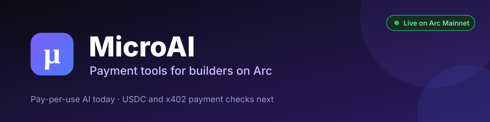
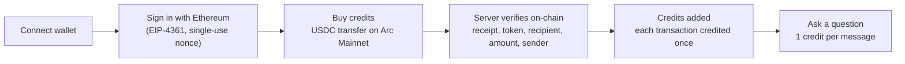

<p align="center">
  
</p>

<p align="center">
  <a href="https://github.com/sahmedonchain/microai/actions/workflows/ci.yml"></a>
  <a href="https://github.com/sahmedonchain/microai/actions/workflows/github-code-scanning/codeql"></a>
  
  
  
</p>

<p align="center">
  <a href="https://microai-tan.vercel.app"><b>Live app</b></a> ·
  <a href="https://microai-tan.vercel.app/security">Security</a> ·
  <a href="https://microai-tan.vercel.app/terms">Terms</a> ·
  <a href="https://microai-tan.vercel.app/privacy">Privacy</a> ·
  <a href="#roadmap">Roadmap</a>
</p>

MicroAI is a developer app for **Arc** that is live on Arc Mainnet today and is growing into a **payment verification tool for builders**. Today it answers Arc and Circle questions, generates code, explains transactions and analyses wallets, paid per use with USDC credits (**1 credit = 0.001 USDC**, no subscription, credits never expire). Next is **MicroAI Verify**: checking USDC and x402 payment setups on Arc before they go live. See [Where MicroAI is going](#where-microai-is-going).

> [!NOTE]
> Live on Arc Mainnet. Experimental and not independently audited. Built on Arc: MicroAI is an independent project, not an official Arc or Circle product.

## Contents

- [Where MicroAI is going](#where-microai-is-going)
- [Live today](#live-today)
- [How it works](#how-it-works)
- [On-chain details](#on-chain-details-arc-mainnet)
- [Security](#security)
- [Reference: API routes and project structure](#reference)
- [Tech stack](#tech-stack)
- [Local development](#local-development)
- [Testing and CI](#testing-and-ci)
- [Roadmap](#roadmap)
- [Contributing and feedback](#contributing-and-feedback)
- [Author](#author)

## Where MicroAI is going

Paying with USDC on Arc looks simple, but the mistakes are easy to make and usually show up after real money has moved:

| Common mistake | What goes wrong |
|---|---|
| USDC has 6 decimals in its ERC-20 interface but 18 as the native gas token | Wrong amount, off by a factor of a million or more |
| A Testnet address used on Mainnet | Money sent to the wrong place, or the transaction fails |
| Wrong chain ID or recipient address | Payment lands on the wrong network or with the wrong person |
| A malformed x402 payment response | Agents and clients cannot pay at all |
| Payment succeeded but the app did not notice | Money moved, the user got no service or credits |

MicroAI already does part of this work in production: it verifies USDC payments on-chain, protects against replays, recovers lost payments and explains transactions. **MicroAI Verify** builds on that foundation. A developer gives it an x402 endpoint (and optionally a transaction hash), and it reports what is right and what is wrong, with evidence and a fix.

**Planned for Verify v1** (engine, API, transaction check and an early-preview page built; proof from outside builders still to come):

- Reads the endpoint's `402` response **without sending any payment**
- Checks the network (Arc Mainnet `5042` or Testnet `5042002`), the USDC address, amount decimals (6 versus 18), the recipient address and the x402 response format
- Optionally checks a transaction hash on-chain against what was expected
- Returns a plain-language report: OK, warning or error for each check, the reason, the proof and how to fix it
- Runs in the browser, nothing to install, free with rate limits

What it will **not** do: send payments, give services a score, call other services good or bad, or check any network other than Arc.

**Try the early preview:** [microai-tan.vercel.app/verify](https://microai-tan.vercel.app/verify). It is not in the app menu yet, it sends no payment, and it is experimental. If it misses something or gets something wrong, please [tell me](https://github.com/sahmedonchain/microai/issues/new?title=Verify%20feedback%3A%20).

<details>
<summary>Illustrative mock-up of a Verify report (not live)</summary>

```text
MicroAI Verify  -  mock-up, not a real result
Endpoint: https://api.example.com/paid      Network: Arc Mainnet (5042)

[OK]     Network     402 response names chain 5042, matching Arc Mainnet
[ERROR]  Amount      Response asks for 1000000000000000000 units of USDC.
                     That is 1 USDC with 18 decimals, but the USDC interface uses 6,
                     so a client would be asked for 1,000,000,000,000 USDC.
                     Evidence: field "amount" in the 402 response
                     Fix: use 1000000 for 1 USDC.
[WARN]   Recipient   Address is valid but was never used before on Arc Mainnet.
                     Check it is the address you intended.
```

</details>

Every stage below starts only when the previous one is proven. See the [Roadmap](#roadmap).

## Live today

The app is a single page with a sidebar. Each entry below is a panel in it.

| Panel | What it does |
|---|---|
| **Chat** | Answers Arc and Circle questions from a knowledge base of 77 curated entries plus the AI model. 1 credit per message. |
| **Copilot** | Writes Solidity, TypeScript and deploy steps for Arc in 9 modes (Architect, Contract, USDC, Circle, Deploy, Audit, Simulate, Debug, Migrate) plus a general mode. It **generates text only**: it does not compile, test or deploy anything. Long answers can be continued at no extra cost. 1 credit per request. |
| **Wallet** | Look up any address, no sign-in. Native and token balances, the 20 most recent transactions, four rule-based risk signals (unlimited approval, high-value transfer, recent contract call, many transactions in 24 hours) and a short AI summary. |
| **Debug** | Paste a transaction hash. Shows status, token transfers, internal transactions, the decoded function (8 common selectors), a suggested corrected flow and an AI explanation. No sign-in. |
| **Credits** | Balance, USDC payment history, buy more credits, and **Recover a payment**: paste the hash of a USDC payment whose credits did not arrive and the server re-checks it. |
| **Ecosystem** | Directory of 81 Arc and Circle projects in 12 categories with search and filters, an AI search over the same list, and Arc-chain TVL for 5 protocols from DeFiLlama. |
| **Grants** | Hand-maintained list of 23 grants, hackathons, bounties, events and programs. |
| **News** | Arc and Circle news pulled from the Arc and Circle blogs, the Circle pressroom, Google News searches and three finance feeds, filtered for relevance and cached for 30 minutes. |
| **Stats** | Latest block, gas price and estimated cost of a transfer, plus USDC received and transaction counts for the MicroAI payment wallet. Chain data is read by the server, not by the browser. |
| **Build status** | Last activity of 24 tracked GitHub repositories, plus an on-chain check of the AchSwap contracts. |

Credit packs are 5, 10, 20 or 50 credits, or any number from 1 to 1000.

## How it works



The browser never decides what was paid. The server reads the transaction receipt from Arc, checks it and then adds credits. If the confirmation is slow or the tab is closed, the transaction hash is kept in the browser and verified again on the next visit. This payment verification is the engine MicroAI Verify will reuse.

Every API route runs through one wrapper (`withApi` in [`lib/api.ts`](lib/api.ts)), in this order:

1. **Kill switch:** AI routes and the purchase route can be paused with an environment variable.
2. **Same-site check:** cross-site write requests are rejected.
3. **Session:** the signed session cookie is read where the route needs sign-in.
4. **Rate limits:** Redis sliding-window limits per IP and per wallet.
5. **Handler:** the input is validated with zod before anything else happens.

Routes that spend credits or call the AI fail closed if the rate limiter is unavailable.

## On-chain details (Arc Mainnet)

Source: [docs.arc.io](https://docs.arc.io/arc/references/connect-to-arc).

| Item | Value |
|---|---|
| Chain ID | `5042` (`0x13b2`) |
| RPC | https://rpc.mainnet.arc.io |
| Explorer | https://explorer.arc.io |
| USDC | `0x3600000000000000000000000000000000000000` |
| EURC | `0xbEf5f6d51CB62b58e6A8f77868681825C6fe21c1` |
| MicroAI payment wallet | `0x78C144A76614A8674285129810555C8bCa78f044` |

USDC is the gas token on Arc. The native balance uses 18 decimals and the USDC ERC-20 interface uses 6 decimals, so amounts are 6-decimal units (1 credit = 1000 units). All addresses live in one registry, [`lib/arcAddresses.ts`](lib/arcAddresses.ts), with the network and docs page for each. Arc Testnet (chain ID `5042002`) has its own addresses and a faucet at https://faucet.circle.com; the MicroAI app itself only runs on Mainnet.

## Security

Implemented controls:

- **Sign-in:** Sign-In with Ethereum (EIP-4361) bound to the app domain and Arc Mainnet chain ID. Nonces are stored in Redis, expire after 5 minutes and work once.
- **Payments:** verified on the server from the Arc receipt: the RPC is checked to be Arc Mainnet, the transaction succeeded, and every USDC transfer in it is read. Transfers from the signed-in wallet to the MicroAI wallet are summed and must match the amount. Each transaction hash can be credited once, enforced atomically in Redis. Payments are verifiable for 7 days.
- **Credits:** never expire. If the AI fails or returns nothing, the credit is refunded automatically.
- **Emergency pause:** AI answers, new credit purchases and the Verify checker can each be paused with an environment variable (`PAUSE_AI`, `PAUSE_PURCHASES`, `PAUSE_VERIFY`) and a redeploy.
- **Same-site checks:** write requests from other sites are rejected on every API route.
- **Headers:** HSTS, `X-Frame-Options: DENY`, `nosniff`, a strict referrer policy and a permissions policy on every response. A Content-Security-Policy is sent in report-only mode. It applies to pages, not to API responses.
- **Abuse limits:** Redis sliding-window rate limits on every API route, keyed by wallet or IP, plus daily caps on the public AI endpoints.
- **Input handling:** request bodies and queries are validated with zod. Chat history from the browser is validated, and third-party text (token symbols, explorer fields) is fenced as data before it reaches the model.
- **Outbound requests:** server-side fetches go through a guarded client that allows only https, blocks private and internal addresses, limits redirects and response size, and applies a timeout.
- **Keys:** the app never asks for a private key or seed phrase.
- **Repository:** the `main` branch is protected: changes go through pull requests, CI must pass, and force pushes are blocked. CodeQL and Dependabot run on the repository.
- **Tests:** 534 tests in 32 files cover sign-in, payment verification, replay and recovery, credit refunds, the emergency kill switch, same-site write checks, rate limiting, prompt handling, the navigation config and the Verify checks, fetcher and test fixtures. Redis, the chain RPC and the AI provider are mocked in these tests and the files say so.

Known limitations:

- Experimental and not independently audited. Do not rely on it for large amounts.
- AI answers can be wrong. Check addresses and parameters against [docs.arc.io](https://docs.arc.io) before sending funds.
- Copilot output is not compiled or tested. Review and test generated code yourself.
- The ecosystem and grants lists are curated by hand and are not independently verified.
- Wallet, Debug and ecosystem search are public and rate limited, so they can return `429`.
- Chain data comes from the Arc RPC and the Arc Explorer API and is unavailable when they are.

To report a vulnerability, see [SECURITY.md](SECURITY.md). Please do not open a public issue for it.

## Reference

<details>
<summary><b>API routes</b></summary>

<br>

All routes are under `/api`. "Sign-in" means a valid session cookie from Sign-In with Ethereum. Every route is rate limited except the read-only `/lab` fixtures.

| Route | Method | Sign-in | Purpose |
|---|---|---|---|
| `/session/nonce` | GET | no | Issue a single-use sign-in nonce |
| `/session` | GET, POST | no | Read the session; verify a signed message and start a session |
| `/credits/balance` | GET | optional | Credit balance |
| `/credits/purchase` | POST | yes | Verify a USDC payment on-chain and add credits |
| `/payment-history` | POST | yes | USDC payment history for the signed-in wallet |
| `/chat` | POST | yes | Chat answer, 1 credit |
| `/copilot` | POST | yes | Copilot answer, 1 credit |
| `/debug-analyze` | POST | optional | Transaction explanation |
| `/wallet` | POST | optional | Wallet analysis |
| `/ecosystem-search` | POST | optional | AI search over the ecosystem list |
| `/ecosystem-tvl` | GET | no | Arc-chain TVL from DeFiLlama |
| `/news` | GET | no | News feed |
| `/stats` | GET | no | MicroAI payment wallet activity |
| `/chain` | GET | no | Fixed read-only chain reads for the Stats page (block, gas price, chain ID, balances) |
| `/verify` | POST | no | Check an x402 endpoint's 402 answer against Arc, and/or a transaction against what the endpoint asked for (no payment sent; 5 a minute, 40 a day per caller) |
| `/github-status` | GET | no | Activity of tracked GitHub repositories |
| `/achswap-onchain` | GET | no | On-chain check of the AchSwap contracts |
| `/csp-report` | POST | no | Receives Content-Security-Policy violation reports |
| `/lab/x402/{case}` | GET | no | Test fixtures for Verify: answer 402 on purpose with one known mistake each, never take a payment |

</details>

<details>
<summary><b>Project structure</b></summary>

```text
app/
  api/            Route handlers (see API routes)
  components/     UI: sidebar shell, panels (tabs/), wallet modal, legal pages
  security/ terms/ privacy/   Public policy pages
lib/
  api.ts          Request wrapper: pause, same-site check, session, rate limits
  purchaseVerification.ts   On-chain USDC payment verification
  credits.ts      Credit balance, spend and refund
  arcAddresses.ts, arcConfig.ts   Addresses and chain settings, one registry
  arcRpc.ts, arcExplorer.ts       RPC and Explorer clients
  safeFetch.ts    Guarded outbound fetch
  siwe.ts, session.ts, nonce.ts   Sign-in
  killSwitch.ts, csrf.ts, csp.ts, rateLimit.ts   Protections
  verify/         MicroAI Verify: x402 parser, checks, guarded fetch, test fixtures
tests/            Vitest suites (Redis, RPC and AI are mocked)
scripts/          One-off maintenance scripts
docs/assets/      Banner and social preview images
proxy.ts          Sets the Content-Security-Policy on page responses
```

</details>

## Tech stack

| Area | Choice |
|---|---|
| App | Next.js 16 (App Router), React 19, TypeScript 5, Tailwind CSS 4, Framer Motion |
| AI | Groq with `openai/gpt-oss-120b` |
| Storage | Upstash Redis (credits, nonces, claims, rate limits, caches) |
| Wallets | Browser wallets through the injected EIP-1193 provider (MetaMask, Coinbase Wallet, Trust Wallet, Brave Wallet); `ethers` 6 verifies signatures on the server |
| Validation | zod 4 |
| Tests | Vitest 5 |
| Package manager | pnpm |
| Hosting | Vercel |

## Local development

Requires Node 24.18.1 or later 24.x (pinned in `.nvmrc`, which CI also reads), pnpm, a [Groq](https://console.groq.com) API key and an [Upstash Redis](https://upstash.com) database.

```bash
git clone https://github.com/sahmedonchain/microai.git
cd microai
pnpm install
cp .env.example .env.local   # then fill in the values
pnpm dev                     # http://localhost:3000
```

| Variable | Required | Used for |
|---|---|---|
| `GROQ_API_KEY` | yes | AI answers |
| `UPSTASH_REDIS_REST_URL` | yes | Redis |
| `UPSTASH_REDIS_REST_TOKEN` | yes | Redis |
| `SESSION_SECRET` | yes | Signing session cookies (use a long random string) |
| `GITHUB_TOKEN` | no | Higher GitHub rate limit for Build status |
| `SIWE_DOMAIN` | no | Pins the sign-in domain; defaults to the request host |
| `CSP_ENFORCE` | no | `1` enforces the Content-Security-Policy; unset or `0` is report-only |
| `PAUSE_AI` | no | `1` pauses Chat, Copilot and Debug analysis |
| `PAUSE_PURCHASES` | no | `1` pauses new credit purchases |
| `PAUSE_VERIFY` | no | `1` pauses the Verify endpoint checker |

Buying credits needs an injected wallet on Arc Mainnet with USDC. Never commit `.env.local`.

## Testing and CI

```bash
pnpm test                          # Vitest
pnpm exec eslint app lib tests     # lint
pnpm exec tsc --noEmit             # typecheck
pnpm build                         # production build
```

[GitHub Actions](.github/workflows/ci.yml) runs install, lint, typecheck, tests and build on every push and pull request. GitHub CodeQL scans the code for security issues.

## Roadmap

This is a direction, not a promise. **A stage starts only when the previous one is proven**, so the order matters more than the dates.

| Stage | What | Status |
|---|---|---|
| **Foundation** | Pay-per-use AI, credits, on-chain payment verification and recovery, wallet and transaction analysis | Live on Mainnet |
| **Hardening** | Automatic credit refund, emergency pause switches, same-site checks, protected `main`, public Security, Terms and Privacy pages, server-side chain reads, Node 24 | Done |
| | Enforce the Content-Security-Policy in production | Next |
| **MicroAI Verify v1** | Check an x402 or USDC payment setup on Arc and verify a transaction on-chain, with a plain-language report | In progress: check engine, API, transaction check and an early-preview page built; proof from outside builders still to come |
| **Testnet proof** | Run a real x402 endpoint on Arc Testnet and publish proof for success, timeout, wrong amount and no response | Planned |
| **Delivery checks** | Catch "payment went through but the service was not delivered" | Planned |
| **Shareable reports** | One link per check, with history, to share with a team | Later |

**Definition of done for Verify v1:** at least 20 test cases pass (good and bad configurations), 5 deliberately broken endpoints are each caught correctly, at least 5 real Mainnet transactions are verified correctly, at least 3 outside builders have used it and given feedback, and at least 1 says it caught a real problem. If builders do not find it useful, the plan changes. Chat and Copilot stay available with no major new development planned, and any wind-down would be announced in advance.

## Contributing and feedback

Building on Arc with USDC or x402? **Tell me where payments get stuck.** Open an [issue](https://github.com/sahmedonchain/microai/issues/new) titled "Builder feedback: ..." with what you tried and what went wrong. That decides what Verify checks first.

Issues and suggestions are welcome. For a larger change, please open an issue first. For security problems, use [SECURITY.md](SECURITY.md) and not a public issue.

## Author

Built solo by **Sahmed Zayan** ([@sahmedonchain](https://x.com/sahmedonchain)) under [BuildOrbit](https://github.com/sahmedonchain).

Links: [Arc docs](https://docs.arc.io) · [Arc Explorer](https://explorer.arc.io) · [Circle developer docs](https://developers.circle.com)
